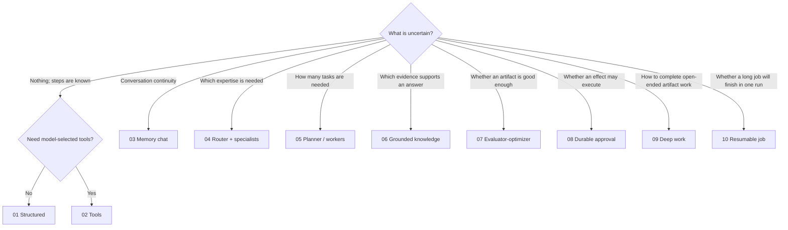

# LangGraph Agentic Patterns

A problem-oriented catalog of ten explicit LangGraph workflows. Use it to choose a graph shape,
understand its trade-offs, and copy only the pieces a real project needs.

Each scenario is a starting point for another project: an independent graph, typed boundaries,
runnable examples, focused tests, and guidance on when to use it. Adapt its dependencies and
domain rules to your application; add infrastructure when that application needs it.

## Run an example

Install Python 3.11+ and [uv](https://docs.astral.sh/uv/), then run from the repository root:

```sh
uv sync --frozen --all-extras
uv run python -m playground_agentic.scenarios.s01_structured.example
```

For live model calls, copy [.env.example](.env.example) to `.env` and fill in your endpoint settings.
`.env` stays local and is ignored by Git. Then run:

```sh
uv run --env-file .env python -m playground_agentic.scenarios.s01_structured.live_example
```

Every scenario includes two deterministic examples in `example.py` and a model-backed
`live_example.py` with local simulated dependencies. The [run guide](docs/running-examples.md)
lists all scenarios, expected outcomes, and separate-process approval and batch recovery commands.

Scenario 10 also has an [OpenTelemetry lab](docs/observability/README.md): traces,
correlated logs, metrics, and a local Grafana dashboard for retries and cross-process recovery.
It runs with a fixture model or your endpoint, including streaming, using official LangChain
callbacks, declarative SDK profiles, and console exporters or OTLP.

## Design rules

- `StateGraph` owns routing, state, concurrency, loops, and termination.
- `create_agent` and Deep Agents appear only as bounded nodes or subgraphs.
- Choose a scenario by problem shape, not by treating IDs as maturity levels.
- Reuse dependency contracts and integration recipes, never a universal graph topology.
- Use Pydantic at boundaries; keep evolving graph state as `TypedDict` unless validation is useful.
- Inject models, tools, stores, retrievers, and executors into `build_graph`.
- Prefer maintained LangGraph, LangChain, Deep Agents, MCP, and Agent Skills primitives.

## How to use the catalog

1. Select the closest problem shape from the table below.
2. Read that scenario's problem, limits, graph, state, and node table.
3. Run or read its two realistic examples; each exercises a different useful route or capability.
   Every `example.py` exposes separate `example_1_*` and `example_2_*` functions; `run_example()`
   only aggregates them for a compact demonstration.
   Then run its `live_example.py` against your model endpoint and inspect the documented outcomes.
4. Copy its `graph.py` and the focused tests into the destination project.
5. Replace boundary contracts and injected dependencies with domain-specific ones.
6. Add only the cross-cutting recipes the project actually needs.
7. Preserve the termination, failure-path, routing, and persistence tests.

Each scenario's copy instructions identify the files and dependencies needed for adoption.

## Choose a scenario

| ID | Scenario | Audience | Problems and example tasks | Complexity | Routing / graph shape | Bounded agent form | Main limitation |
|---:|---|---|---|---:|---|---|---|
| 01 | [Structured Decision Workflow](src/playground_agentic/scenarios/s01_structured/README.md) | Product | intake, extraction, classification, transformation | 1/5 | Fixed DAG with typed decisions and conditional branches | None | Steps must be known in advance |
| 02 | [Controlled Tool Workflow](src/playground_agentic/scenarios/s02_tools/README.md) | Both | calculation, lookup, guarded API operations | 2/5 | Explicit `model <-> ToolNode` loop with terminal budget | No prebuilt agent; graph owns the loop | Model-selected tools expand the security surface |
| 03 | [Chat with Memories](src/playground_agentic/scenarios/s03_memory_chat/README.md) | User-chat | assistant, project copilot, contextual support | 3/5 | Load memory -> bounded chat agent -> extract/compact -> persist | One bounded `create_agent` node | Memory extraction can persist false or sensitive facts |
| 04 | [Router + Parallel Specialists](src/playground_agentic/scenarios/s04_specialists/README.md) | Both | architecture, product, delivery, and risk reviews | 3/5 | Route -> `Send` specialist subgraphs -> reduce -> resolve | Per-invocation bounded specialists | Parallel opinions cost more and can conflict |
| 05 | [Planner / Orchestrator-Worker](src/playground_agentic/scenarios/s05_orchestrator/README.md) | Product | research brief, migration plan, variable-size tasks | 4/5 | Plan -> dynamic `Send` workers -> synthesize -> review/replan | Plain workers by default; bounded agent optional | Planning adds latency and nondeterminism |
| 06 | [Grounded Knowledge Workflow](src/playground_agentic/scenarios/s06_rag/README.md) | Both | documentation Q&A, evidence-based support | 3/5 | Route -> retrieve -> grade -> rewrite/answer -> ground | Controlled workflow, not agent architecture | Output quality is bounded by available evidence |
| 07 | [Evaluator-Optimizer](src/playground_agentic/scenarios/s07_evaluator/README.md) | Product | specifications, reports, release notes, rubric artifacts | 3/5 | Generate -> evaluate -> bounded revise loop | None required | Generator and evaluator may share blind spots |
| 08 | [Durable Approval and Side Effects](src/playground_agentic/scenarios/s08_hitl/README.md) | Product | refunds, access changes, production mutations | 4/5 | Prepare -> policy -> interrupt -> execute -> verify/compensate | None required | External effects must be idempotent |
| 09 | [Bounded Deep Work Agent](src/playground_agentic/scenarios/s09_deep_worker/README.md) | Product | repository investigation, multi-file artifact work | 5/5 | Scope -> Deep Agent subgraph -> deterministic validation | One permission-scoped Deep Agent | Highest cost and security surface |
| 10 | [Durable Resumable Job](src/playground_agentic/scenarios/s10_resumable/README.md) | Product | bulk enrichment, document batches, long-running jobs | 4/5 | Partition -> `Send` workers -> assess/retry -> finalize | Plain workers; bounded agent optional | Checkpoint and replay semantics require care |



## Feature matrix

`Runnable lab` means a complete optional integration with a separate run guide.
`Core` means the scenario teaches and tests the feature. `Recipe` means it can be attached without
changing the scenario's defining topology.

| ID | Agent loop | Model-callable tools | Skills | Memory | MCP | Durability / HITL | OTel |
|---:|---|---|---|---|---|---|---|
| 01 | — | — | — | Request state | — | Optional checkpointer | Recipe |
| 02 | Explicit `ToolNode` loop | Core allowlist | Recipe | Per-run messages | Optional tool source | Optional checkpointer | Recipe |
| 03 | Bounded `create_agent` | Optional | Recipe | Thread + long-term `Store` | Optional | Checkpointer core | Recipe |
| 04 | Bounded per specialist | Optional per specialist | Recipe | Run-local by default | Optional | Subgraph persistence choice | Recipe |
| 05 | Optional worker loops | Optional per worker | Recipe | Plan and artifacts | Optional | Optional checkpoint/approval | Recipe |
| 06 | Rewrite loop, not agent loop | Retriever is application-owned | — | Evidence in run state | Adapter variant | Optional checkpointer | Recipe |
| 07 | Evaluator loop | Deterministic validators only | Optional input adapter | Draft and feedback | — | Optional checkpointer | Recipe |
| 08 | — | Executor is not model-exposed | Optional policy source | Durable action state | Optional behind executor | Checkpointer + `interrupt` core | Recipe |
| 09 | Deep Agent internal loop | Core, least privilege | Core | Virtual workspace; `Store` optional | Optional | Optional tool approval/checkpoint | Recipe |
| 10 | — by default | Worker functions | — | Durable job state | Optional source/sink | Retry and resume core | Runnable lab |

## Feature-to-scenario index

| Feature | Primary demonstrations | Optional use |
|---|---|---|
| Conditional routing | 01, 06, 08 | Most workflows |
| Explicit tool loop | 02 | — |
| Bounded `create_agent` | 03, 04 | 05 |
| Deep Agent | 09 | Avoid unless open-ended work justifies it |
| `Send` and reducers | 04, 05, 10 | — |
| Compiled subgraphs and state mapping | 04, 09 | Composition in a destination graph |
| Checkpointer | 03, 08, 10 | 04, 05, 06, 07, 09 |
| Long-term `Store` | 03 | 09 |
| Agent Skills | 09 | 02, 03, 04, 05, 07 |
| MCP client | 06 adapter | 02, 05, 09 |
| `interrupt` / `Command` | 08 | 05, 09 |
| Domain retries | 10 | 02, 05, 06 |
| Node RetryPolicy and CachePolicy | Resilience recipe (not a core demonstration) | 02, 05, 06, 10 |
| Agent middleware | 03, 04, 09 | Any bounded agent node |
| OpenTelemetry | 10: traces, logs, metrics, Collector/Grafana lab | Every scenario at the application boundary |

## Cross-cutting recipes

- [Choose and inject a model](docs/recipes/models.md)
- [Persistence, memory, and subgraph scope](docs/recipes/persistence.md)
- [MCP as an adapter](docs/recipes/mcp.md)
- [Agent Skills](docs/recipes/skills.md)
- [Agent middleware](docs/recipes/middleware.md)
- [Retries, caching, and streaming](docs/recipes/resilience.md)
- [Evaluation without a playground evaluator](docs/recipes/evaluation.md)
- [Observability and security](docs/recipes/observability-security.md)

The [recipe index](docs/recipes/README.md) maps common integration needs to these snippets.
Copy only what the destination application needs.

## Repository layout

```text
.env.example                 # committed template for local .env settings
src/playground_agentic/
  scenarios/                 # ten graphs, offline/live examples, and focused tests
  example_support.py         # endpoint and output helpers for live demos
  testing.py                 # deterministic BaseChatModel for examples/tests
docs/
  running-examples.md         # setup, commands, and expected outcomes
  recipes/                   # optional integration snippets
  observability/             # optional three-signal lab, dashboard, and investigation guide
tests/                       # catalog, live wiring, and regression checks
```

## Validate the reference code

The checks run offline, apart from the local stdio MCP fixture; no model credentials are needed.

```sh
uv sync --frozen --all-extras
uv run ruff check .
uv run pyright
uv run pytest
```

Each scenario contains two domain-realistic examples and focused tests for their observable
outcomes, alongside tests for limits, failures, or persistence behavior.

All ten live wiring paths are also tested with injected models, including schema parsing and
fresh-process checkpoint resume. These tests require no endpoint and do not measure model quality.
When adapting a pattern, use your own model and domain cases to evaluate answer quality.

## License

[MIT](LICENSE). You can copy and adapt the scenarios in your own projects.

This is an independent project, not affiliated with or endorsed by LangChain.

## Official references

- [LangGraph Graph API](https://docs.langchain.com/oss/python/langgraph/use-graph-api)
- [Persistence](https://docs.langchain.com/oss/python/langgraph/persistence)
- [Subgraphs](https://docs.langchain.com/oss/python/langgraph/use-subgraphs)
- [Interrupts](https://docs.langchain.com/oss/python/langgraph/interrupts)
- [Streaming](https://docs.langchain.com/oss/python/langgraph/streaming)
- [LangChain middleware](https://docs.langchain.com/oss/python/langchain/middleware/built-in)
- [LangChain MCP adapters](https://docs.langchain.com/oss/python/langchain/mcp)
- [Deep Agents Skills](https://docs.langchain.com/oss/python/deepagents/skills)
- [Deep Agents permissions](https://docs.langchain.com/oss/python/deepagents/permissions)
