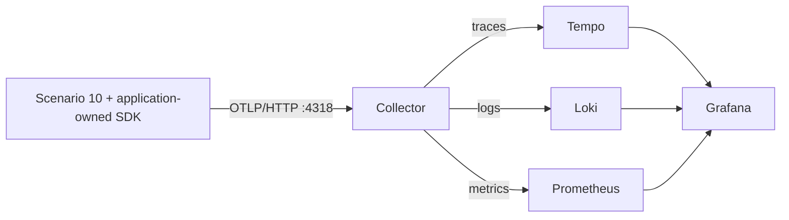

# Observe a resumable document batch

Scenario 10 is the optional three-signal reference: workflow/worker/model traces,
correlated structured logs, and metrics with trace exemplars. It demonstrates normal work,
transient retries, rejected documents, and recovery in a new process. Its graph remains independent
of OpenTelemetry; copy the boundaries that suit your own application. The application owns SDK
configuration, the official OTel LangChain callback owns framework/model instrumentation, and
small business boundaries measure outcomes and retries that the framework cannot infer.

## Run without a backend

From the repository root:

```sh
uv sync --frozen --all-extras
uv run python -m playground_agentic.scenarios.s10_resumable.otel_example mixed
```

The fixture model summarizes three simulated documents: the audit policy succeeds, the supplier
document gateway times out once and then succeeds, and an unreadable scan fails permanently.
Expect a `partial` result, four worker attempts, one domain retry, and two model calls. Console
exporters print all three signals on shutdown. The CLI also prints the business result separately;
that output contains document summaries, whereas exported telemetry does not.

For real inference, copy [`.env.example`](../../.env.example) to the uncommitted `.env`, fill in
`LLM_*` and `OTEL_GENAI_PROVIDER`, and add `--live`:

```sh
uv run --env-file .env python -m playground_agentic.scenarios.s10_resumable.otel_example mixed --live
```

The gateway failures remain simulated. A mixed batch makes two logical model calls; provider
retries may make additional HTTP requests. Fixture usage is explicitly synthetic (40 input / 16
output tokens per call). Live usage comes only from `AIMessage.usage_metadata`; missing usage
produces no token measurement. This text-only demo does not estimate costs. Add `--stream` to
consume streamed model output and collect first-chunk and inter-chunk timing:

```sh
uv run --env-file .env python -m playground_agentic.scenarios.s10_resumable.otel_example mixed --live --stream
```

The same flag works with fixtures; their timings demonstrate instrumentation, not model performance.
Chunks are accumulated into the final business result. A chunk may contain several tokens, and
streamed usage depends on the provider/adapter returning a final usage record.
The CLI sets `streaming=True` on the LiteLLM adapter. Calling `.stream()` alone can silently
fall back to `.invoke()` when the adapter has disabled streaming. Injected models must support
and enable streaming; this example rejects a non-streaming fallback instead of displaying empty
timing panels as though streaming had been tested.
For `openai/` and `azure/` model identifiers, the factory also requests
`stream_options={"include_usage": true}` explicitly: the adapter may not recognize a custom
model alias when deciding whether to request the final usage chunk. The endpoint must supply
that chunk for streamed token metrics. See [LiteLLM's usage guidance](https://docs.litellm.ai/docs/harness/opencode).
Provider metadata is set on the model because LangChain's generated metadata can override
per-call hints. Model identifiers come from adapter parameters and may retain a routing prefix
such as `openai/`; no custom wrapper rewrites provider usage.

## Configuration and instrumentation

The console and OTLP [SDK profiles](../../src/playground_agentic/scenarios/s10_resumable/otel-otlp.yaml)
use OpenTelemetry's public `load_config_file` / `configure_sdk` API. They configure all three
providers, resources, batching, sampling, propagators, metric views, and exporters. The CLI
selects a profile with `--export`; an explicit `OTEL_CONFIG_FILE` takes precedence. Relative paths
are resolved from the working directory. The Collector has its own separate pipeline configuration.

Keep credentials in the uncommitted `.env` and run with `uv run --env-file .env`. YAML is
authoritative for SDK construction: only variables explicitly referenced with `${VAR:-default}`
are substituted. For example, `OTEL_TRACES_SAMPLER_ARG` sets the ratio; setting
`OTEL_TRACES_SAMPLER=always_off` does not replace the sampler selected in YAML. Edit a copied
profile for different exporters or sampling policy. `OTEL_EXPORTER_OTLP_ENDPOINT` is a base URL
without a trailing slash or signal path; profiles append `/v1/traces`, `/v1/logs`, and `/v1/metrics`.

The locked reference uses Python SDK **1.45.0**, configuration/logging **0.66b0**, and official
GenAI LangChain instrumentation **1.2b0**. Declarative configuration and GenAI instrumentation
are still experimental. This is a tested adoption of their released APIs, not a promise of
stable APIs across upgrades. Use `uv sync --frozen --all-extras` for the tested combination.

The official `OpenTelemetryLangChainCallbackHandler` is supplied via graph `config["callbacks"]`
and inherited by model calls. No custom model wrapper is needed. Version 1.2b0's global
`LangChainInstrumentor().instrument()` also injects into LangGraph's lifecycle manager, where
its missing `on_resume` callback produces a warning during recovery. Explicit callback
registration avoids that issue without patching third-party classes. Do not enable both forms
of instrumentation. This example tests synchronous parallel workers and process recovery;
the upstream instrumentor documents limitations for nested async contexts, so validate async
graphs before reusing it there.

## Run the local observability lab

Docker Compose supplies an OTel Collector and Grafana's development LGTM image containing Tempo,
Loki, and Prometheus. Versions are pinned and published ports bind only to loopback. The initial
pull is large; allow several minutes. Use console mode if Docker is unavailable.

```sh
docker compose -f docs/observability/compose.yaml up -d --wait --wait-timeout 240
uv run --env-file .env python -m playground_agentic.scenarios.s10_resumable.otel_example mixed --export otlp --repeat 30 --interval 2
```

Open [Grafana](http://localhost:3000/d/langgraph-resumable) and the **LangGraph · Resumable job**
dashboard. No login is needed for this local backend. Change the Service field if you changed
`OTEL_SERVICE_NAME`. SDK metrics export every five seconds and on graceful exit; allow a few
seconds for ingestion. Repeating in one process gives rate queries multiple samples. Adding
`--live` to that command makes 60 logical model calls.



LGTM's own Collector routes the streams internally. Our outer Collector demonstrates memory
limiting before batching, bounded queues, finite export retries, and its own operational metrics.
Its [health endpoint](http://localhost:13133) means the process is ready, not that the backend is
storing data. Check queries and exporter metrics for end-to-end health.

Stop while retaining telemetry: `docker compose -f docs/observability/compose.yaml down`.
To also delete this lab's stored telemetry, use `down --volumes`. Neither command deletes the
application checkpoints under `.demo-state/`.

## Investigate a partial result

1. Find a `partial` invocation and its failed/retryable worker counts in the dashboard.
2. Open Grafana Explore, select **Tempo**, and search by the `trace_id` printed by the CLI.
   Alternatively use TraceQL: `{ resource.service.name = "langgraph-resumable-demo" }`.
3. Expand `job.invoke`, then `invoke_workflow document_batch`. Four `worker.process` spans
   represent actual attempts, and two `chat fixture-summary` spans represent model calls.
   The callback follows LangChain run ancestry: model spans and plain business worker spans are
   siblings under the workflow. Compare their timing and the supplier's retry and scan's failure.
   They share the root trace, including across parallel workers; tests verify it.
4. Follow a span's log link, or query **Loki** with
   `{service_name="langgraph-resumable-demo"} | trace_id = "<printed trace ID>"`.
   Fixed event bodies such as `worker.finished` carry outcome/attempt metadata and trace/span IDs.
5. In **Prometheus** Explore, query `playground_worker_duration_seconds_bucket`, enable exemplars,
   and follow one to Tempo. Exemplars carry sampled trace references without adding trace IDs to
   every metric series. Not every observation has an exemplar.

The root records a business outcome and stays `UNSET` for valid partial/failed results. Failed or
retryable workers are `ERROR`; unexpected exceptions make both worker and root `ERROR`. Bounded
error classifications are `transient_dependency`, `unprocessable_item`, `worker_error`,
and `workflow_error`. The official GenAI metrics/spans also report exception class names as
`error.type`; keep those classes bounded. No raw exception text or stack is exported.

## Follow a crash across processes

Run these separately, keeping the same directory and model mode:

```sh
uv run --env-file .env python -m playground_agentic.scenarios.s10_resumable.otel_example start --export otlp
uv run --env-file .env python -m playground_agentic.scenarios.s10_resumable.otel_example resume --export otlp
```

`start` completes the policy, deliberately raises a worker exception before summarizing the
runbook, closes SQLite, flushes telemetry, and exits with `interrupted`. This is a controlled crash
simulation, not an OS hard kill. `resume` loads the checkpoint and executes only the runbook. Its
new root trace has a **span link** to the previous invocation's root. Inspect it in Tempo; the two
invocations do not share a trace. Use `--directory .demo-state/otel-job-2` for another fresh job.

Only W3C `traceparent` is persisted in the correlation sidecar; no baggage or provider data.
Missing/corrupt sidecar data loses correlation, not checkpoint recovery. The sidecar is best-effort
and not transactional with SQLite. Only one process may operate on the job directory at a time.
A destination application should persist correlation with its job metadata.

In a request-serving application, honor accepted incoming context instead of creating the root
context used by this CLI. Across queues/processes, explicitly inject/extract W3C context using a
maintained transport instrumentor. Review incoming baggage; do not propagate baggage or trace
headers indiscriminately to external model providers.

## Metric contract

| Instrument | Type / unit | Dimensions | Meaning |
|---|---|---|---|
| `playground.job.invocations` | Counter / `{invocation}` | workflow, phase, outcome | Finished invocations, including errors; start and resume count separately |
| `playground.job.duration` | Histogram / `s` | workflow, phase, outcome | Invocation duration, excluding time between processes |
| `playground.worker.attempts` | Counter / `{attempt}` | workflow, outcome | Every execution, including crashes and retries |
| `playground.worker.duration` | Histogram / `s` | workflow, outcome | One execution's duration |
| `playground.worker.retries` | Counter / `{attempt}` | workflow | Executed domain attempts numbered greater than one; crash replay is not a new domain attempt |
| `playground.worker.active` | UpDownCounter / `{worker}` | workflow | Executing workers; brief bursts can fall between exports |
| `gen_ai.client.operation.duration` | Histogram / `s` | operation, provider, request/response model, error type | Logical model invocation including adapter retries |
| `gen_ai.client.token.usage` | Histogram / `{token}` | operation, provider, request/response model, token type | Reported input/output tokens; use the histogram sum for totals |
| `gen_ai.client.operation.time_to_first_chunk` | Histogram / `s` | operation, provider/model, error type | Time until the first streaming chunk |
| `gen_ai.client.operation.time_per_output_chunk` | Histogram / `s` | operation, provider/model, error type | Instrumentor's streaming inter-chunk measurement, not per-token latency |
| `gen_ai.invoke_workflow.duration` | Histogram / `s` | workflow name, error type | Framework workflow duration |

These GenAI names describe the **released instrumentor's contract**. The evolving semantic
conventions also describe separate input/output token counters; the locked instrumentor still
emits the token histogram above. Do not synthesize duplicate counters just to match unreleased
conventions. Recheck names, units, labels, and dashboard queries together when upgrading.
Tool instrumentation is covered by a focused test; this document batch does not invent tool
calls just to populate a tool panel. Agent/retrieval telemetry needs examples of those operations.

SDK views allowlist dimensions. Job/item/user IDs, content, and arbitrary errors must never be
metric dimensions. Provider/model names come from a bounded deployment catalog. Signals share
`service.name`, `service.version`, and per-process `service.instance.id`; the latter prevents
independent cumulative writers from colliding. Short-lived CLI processes create short-lived series.
Raw counters illustrate executed work; they are not durable business totals or a billing ledger.

Prometheus translates dots to underscores and adds unit/type suffixes. Useful queries:

```promql
sum by (workflow_outcome) (playground_job_invocations_total)
sum by (work_outcome) (rate(playground_worker_attempts_total[5m]))
histogram_quantile(0.95, sum by (le) (rate(playground_job_duration_seconds_bucket[5m])))
sum(rate(gen_ai_client_token_usage_sum{gen_ai_token_type="input"}[5m]))
otelcol_exporter_queue_size{exporter="otlp_http/lgtm"}
```

Filter by `service_name` in a shared backend. One-shot runs may lack enough samples for `rate`;
an empty rate panel does not prove export failed. Fast fixtures fall in the first histogram bucket.
Application durations have explicit buckets; model durations use the GenAI recommended boundaries.
Neither latency percentiles nor sampled traces measure answer quality.

For a long-running destination service, define alert thresholds from its SLOs: sustained root
errors, exhausted item failures, p95 latency, or queue growth. Also monitor Collector
`otelcol_exporter_send_failed_*`, `otelcol_exporter_enqueue_failed_*`,
`otelcol_receiver_refused_*`, and queue size/capacity. Failure counters can be absent until a failure.
Assign an owner before routing alerts, and exclude intentional fixture failures.

To exercise an exporter outage, stop only this lab's Collector, run one fixture batch, then restart
the Collector:

```sh
docker compose -f docs/observability/compose.yaml stop collector
uv run python -m playground_agentic.scenarios.s10_resumable.otel_example mixed --export otlp
docker compose -f docs/observability/compose.yaml start collector
```

The business result is still `partial`; SDK stderr reports failed exports and shutdown can take
longer while timeouts expire. That run may be missing from the backend. Run again after recovery
to confirm new data arrives. This deliberately demonstrates loss, not guaranteed delivery.

## Sampling, privacy, and lifecycle

- The entry point configures global providers once and closes them in `finally`, with batched
  span/log export, periodic metrics, and shutdown flushes. Libraries and `graph.py` never configure
  global providers. An already-configured SDK is rejected; a destination service must reuse its
  providers. Root Python logger handlers are unchanged.
- A private logger bridges fixed events to OTel and gets trace/span correlation from active context.
  It does not capture provider debug logs. The maintained logging bridge is now in
  `opentelemetry-instrumentation-logging`, replacing the deprecated SDK handler.
- The YAML parent-based ratio sampler with `OTEL_TRACES_SAMPLER_ARG=1.0` retains every demo
  trace. Try `0.0`: logs and metrics remain but trace links cannot resolve. Lower head sampling cannot
  guarantee retaining errors. Tail sampling requires full traces arriving at a suitably sized
  Collector, all spans of a trace reaching the same sampler, and additional memory/latency.
- Message capture is `NO_CONTENT`; content events and upload hooks are rejected. This alone does
  not remove error descriptions from the official instrumentor, so `SafeSpanExporter` allowlists
  span attributes, drops events and status descriptions, and delegates transport to standard
  exporters. Keep the `playground_safe` exporter when customizing these profiles. It is registered
  as a public exporter entry point in `pyproject.toml`.
- Prompts, outputs, raw exceptions, headers, endpoint URLs, document text, and user identities stay
  out of exported signals. Only opaque job/item IDs belong on spans/logs. Span/operation names,
  model names, resource attributes, and span links are trusted application configuration, not
  user input. The exporter is a policy for this example, not a universal content scrubber. Review
  those boundaries when adding integrations; do not put secrets in `.env` resource attributes.
- Export is best-effort, not an audit log. Full queues, hard kills, and prolonged outages can lose
  telemetry. Collector queues here are in memory. Export outages do not change completed business
  results; inspect SDK stderr and Collector metrics when diagnosing missing signals.
- Sampling affects spans/exemplars, not counters. Replays record executed work; neither telemetry
  nor checkpointing provides exactly-once accounting or external side effects.

## What to copy, and what remains application-specific

Use [telemetry.py](../../src/playground_agentic/scenarios/s10_resumable/telemetry.py) for business
boundaries and [otel_sdk.py](../../src/playground_agentic/scenarios/s10_resumable/otel_sdk.py) for
standalone startup and callback integration. Copy the desired `otel-*.yaml` profile, observability
dependencies, the exporter entry-point registration from `pyproject.toml` (adjust its import
path), and relevant tests. [otel_example.py](../../src/playground_agentic/scenarios/s10_resumable/otel_example.py)
shows where to pass the callback and how to persist trace links. In an instrumented service,
reuse existing providers and review existing framework instrumentation to avoid duplicates.

Deployment choices remain with the destination project: TLS/authentication, retention/deletion,
access control, persistent queues, collector scaling, alert routing, and SLO thresholds. Detailed
multimodal/cache/reasoning usage, HTTP request spans, and runtime/host metrics need corresponding
provider/transport/runtime instrumentation. Verify what your adapter actually returns; this
text-only demo does not validate those breakdowns. Add quality evaluations separately. LGTM here
is a learning backend. Collector 0.161.0 is pinned because release 0.162.0 has no multi-platform
image manifest at verification time; Grafana LGTM is 0.35.0.

Python traces/metrics are stable; Python logs and GenAI semantic conventions remain in development.
Upgrade deliberately: update the lock, run the telemetry tests (especially privacy, streaming,
sampling, and fresh-process recovery), then verify all three signals and every dashboard query
against the local lab. Do not assume beta callbacks or GenAI metric names remain unchanged.

## Validation and official references

```sh
uv run pytest src/playground_agentic/scenarios/s10_resumable/tests/test_observability.py
```

Tests check parallel span parents, log correlation, outcomes/retries/usage, exemplars, attribute
allowlists, privacy, sampling, declarative configuration, provider ownership, streaming, tool
callbacks, the real LiteLLM adapter with mocked provider I/O, and OTLP protobuf export plus recovery
across fresh processes. The local HTTP receiver test requires neither Docker nor a model endpoint.
The full Grafana lab is a separate manual integration exercise.

- [Python signal status](https://opentelemetry.io/docs/languages/python/)
- [Python declarative configuration](https://opentelemetry-python.readthedocs.io/en/latest/sdk/configuration.html)
- [Official OTel LangChain/LangGraph instrumentation](https://github.com/open-telemetry/opentelemetry-python-genai/tree/main/instrumentation/opentelemetry-instrumentation-genai-langchain)
- [Python exporters](https://opentelemetry.io/docs/languages/python/exporters/)
- [Python logging bridge](https://opentelemetry-python-contrib.readthedocs.io/en/latest/instrumentation/logging/logging.html)
- [Collector configuration](https://opentelemetry.io/docs/collector/configuration/)
- [Collector resiliency](https://opentelemetry.io/docs/collector/resiliency/)
- [Collector OTLP HTTP exporter and current component name](https://github.com/open-telemetry/opentelemetry-collector/blob/main/exporter/otlphttpexporter/README.md)
- [GenAI operation metrics](https://github.com/open-telemetry/semantic-conventions-genai/blob/main/docs/gen-ai/gen-ai-metrics.md)
- [GenAI token counters](https://github.com/open-telemetry/semantic-conventions-genai/blob/main/docs/gen-ai/gen-ai-token-metrics.md)
- [Grafana's development LGTM image](https://grafana.com/docs/opentelemetry/docker-lgtm/)
