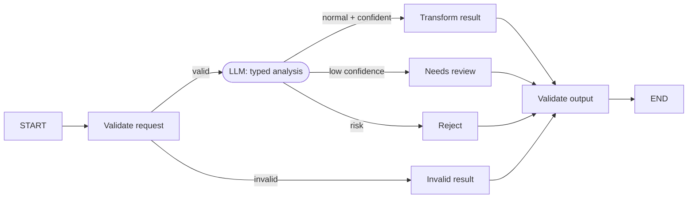

# Scenario 01 — Structured Decision Workflow

## Problem

Run a known sequence of model and deterministic steps while keeping every branch and terminal
result explicit. The example validates an intake, asks for a typed analysis, then accepts, rejects,
or requests review based on category and confidence.

## Choose this when

- The business process and possible outcomes are known in advance.
- Model output can be constrained to a Pydantic contract.
- Predictability and testable routing matter more than open-ended autonomy.

## Avoid when

- The model must decide how many tasks or tool calls are required; use 02 or 05.
- Conversation state must survive turns; use 03.

## Graph

## State and contracts

- `IntakeRequest`, `Analysis`, and `WorkflowResult` are Pydantic boundary contracts.
- `StructuredState` is a lightweight `TypedDict` carrying only data needed between nodes.
- The injected `Analyzer` is the only model-dependent boundary.

## Nodes

| Node | Kind | Responsibility | Failure behavior |
|---|---|---|---|
| `validate` | Deterministic | Validate and normalize request | Produces explicit `invalid` result |
| `analyze` | LLM/injected | Return typed category, summary, confidence, entities | Model/schema exception fails the run |
| `transform` / `review` / `reject` | Deterministic | Create the selected result contract | Pydantic validation fails closed |
| `verify` | Deterministic | Validate the final boundary | Prevents malformed output from leaving |

## Features and decisions

Core: structured output, conditional edges, Pydantic boundaries, explicit terminals. Deliberately
absent: tools, memory, agents, persistence, MCP, and feedback loops.

## Examples

Run `example.py` as a module for the two deterministic examples below. Use [live_example.py](live_example.py) for the real-model demonstration, with local simulated dependencies. See the [run guide](../../../../docs/running-examples.md) for setup, exact commands, and expected outcomes.

| Example | Problem demonstrated | Graph behavior | Useful result |
|---|---|---|---|
| Duplicate invoice triage | A tenant supplies both its tenant ID and duplicated invoice ID | Validate, classify as support, extract identifiers, accept | A typed case that can enter the billing-support queue without pretending to resolve the invoice |
| Unsafe access request | A caller asks support to bypass SSO and export secrets | Validate, classify as risk, follow the reject branch | A typed rejection that prevents an unsafe request from entering normal fulfillment |

The workflow solves routing and transformation, not the downstream billing or security work. Both
inputs therefore contain everything this graph actually needs to make its decision.

## Advantages and limits

The topology is readable, cheap, easy to test, and suitable for high-control product flows. It
cannot discover new steps, and confidence remains a model claim unless separately calibrated.

## Copy into a project

1. Copy `graph.py` and `tests/test_scenario.py`.
2. Keep `StructuredState`; replace the three Pydantic domain contracts.
3. Implement `Analyzer` in the application layer, using structured model output or a deterministic
   classifier as appropriate.
4. Replace routing thresholds and terminal statuses with domain policy.
5. Preserve invalid, low-confidence, risk, and accepted-route tests.

Dependencies: `langchain`, `langgraph`, `pydantic`.

## Tests

The focused tests cover accepted, review, reject, invalid-input, and topology behavior.
