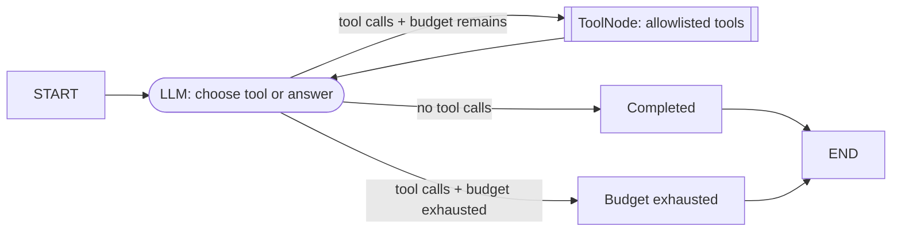

# Scenario 02 — Controlled Tool Workflow

## Problem

Let a model select from a small tool allowlist while the parent `StateGraph` owns execution,
errors, streaming, the loop, and its hard step budget.

## Choose this when

- A request may require zero or more model-selected tool calls.
- You need to see and customize the model/tool cycle directly.
- Tools are narrow enough to authorize before graph construction.

## Avoid when

- Steps and tool calls are predetermined; ordinary nodes are simpler.
- The task requires planning many unknown workers; use 05.
- The tool surface is broad, mutating, or cannot be independently authorized.

## Graph

## State and contracts

- `ChatRequest` and `ChatResult` validate the public boundary.
- `ToolLoopState.messages` uses LangGraph's `add_messages` reducer.
- `ToolPolicy` owns the allowlist and maximum graph steps locally.

## Nodes

| Node | Kind | Responsibility | Failure behavior |
|---|---|---|---|
| `model` | LLM | Stream one response and increment step count | Empty or non-AI response fails the run |
| `tools` | `ToolNode` | Execute allowlisted calls and retain tool errors | Tool errors return as `ToolMessage` data |
| `done` | Deterministic | Mark normal completion | — |
| `budget` | Deterministic | Stop a continuing model loop | Returns explicit terminal status |

## Features and decisions

Core: `ToolNode`, tool binding, allowlist, explicit loop, message reducer, handled tool errors,
step budget, token streaming. MCP can supply tools as an adapter; Skills and persistence are
optional and do not change the topology.

## Examples

Run `example.py` as a module for the two deterministic examples below. Use [live_example.py](live_example.py) for the real-model demonstration, with local simulated dependencies. See the [run guide](../../../../docs/running-examples.md) for setup, exact commands, and expected outcomes.

| Example | Problem demonstrated | Selected tool | Useful result |
|---|---|---|---|
| Delayed shipment lookup | Support has a concrete tracking ID but must not invent delivery status | `lookup_shipment` | The authoritative hub status and revised ETA |
| SLA service credit | Operations needs a reproducible proportional credit from fee, downtime, and billing period | `calculate_service_credit` | A deterministic EUR amount calculated from validated arguments |

These are model-selected operations with sufficient inputs and independently checkable tool
outputs. They also show where to replace the example tools with an authorized domain allowlist.

## Advantages and limits

The control loop is visible and easier to govern than a general agent. It still trusts the model
to propose arguments, so each tool must validate input, authorize the caller, apply timeouts, and
enforce idempotency for mutations.

## Copy into a project

1. Copy `graph.py` and its tests.
2. Define a small domain tool allowlist in the application layer, as `example.py` demonstrates.
3. Inject the destination model and construct `ToolPolicy` from authenticated policy.
4. Adjust `ChatRequest.max_steps`; never rely only on a prompt to terminate.
5. Add tool-specific error, authorization, and repeated-call tests.

Dependencies: `langchain`, `langgraph`, `pydantic`.

## Tests

The tests execute real `ToolNode` calls, stream model chunks, expose tool errors, and prove the
request budget terminates the loop.

`ToolPolicy.max_tool_calls` independently caps total tool execution, including parallel batches. A batch that exceeds the remaining allowance is denied in full. Budget exits return matching ToolMessages for all unexecuted calls. The `run` and `stream_text` helpers size the recursion guard to the request step budget.
