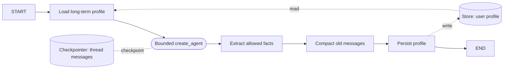

# Scenario 03 — Chat with Memories

## Problem

Serve a human conversation with separate short-term thread history and long-term user facts while
keeping one bounded chat agent subordinate to an explicit memory workflow.

## Choose this when

- A user expects continuity inside one conversation and across new conversations.
- The application can define identity, retention, deletion, and memory extraction policy.
- A bounded `create_agent` node is useful for conversational response behavior.

## Avoid when

- The task is a one-shot product workflow; request state is enough.
- Facts cannot safely be inferred and persisted from conversation.

## Graph

## State and contracts

- `ChatTurn` and `TurnResult` are public contracts.
- `MemoryState.messages` uses `add_messages`; `profile` and `summary` are distinct fields.
- `MemoryContext.user_id` comes from runtime context, not model output.
- The checkpointer owns thread state; `Store` owns cross-thread profile facts.

## Nodes

| Node | Kind | Responsibility | Failure behavior |
|---|---|---|---|
| `load_memory` | Store access | Load namespaced long-term profile | Missing Store fails explicitly |
| `chat_agent` | Bounded agent | Answer with limited model calls | Middleware stops runaway calls |
| `extract_memory` | Deterministic example | Extract only allowlisted profile fields | Unknown facts are ignored |
| `compact` | Deterministic | Remove old messages and extend summary | Bounded by message/character limits |
| `persist_memory` | Store access | Write user profile | Missing Store fails explicitly |

## Features and decisions

Core: checkpointer, `thread_id`, runtime context, `Store`, message reducer, compaction, deletion,
bounded `create_agent`, model-call middleware. This example demonstrates semantic profile memory;
episodic memory and background extraction should be separate destination variants.

## Examples

Run `example.py` as a module for the two deterministic examples below. Use [live_example.py](live_example.py) for the real-model demonstration, with local simulated dependencies. See the [run guide](../../../../docs/running-examples.md) for setup, exact commands, and expected outcomes.

| Example | Durable facts | Boundary demonstrated | Useful result |
|---|---|---|---|
| Developer preferences | Preferred example language and response style | Save in one project thread, close storage, recall in a new thread | The copilot uses Python examples and concise answers without asking again |
| Support contact preferences | Incident-update channel and timezone | Separate user namespace, close storage, recall in a new incident thread | Support knows to use email and Europe/Paris time without leaking another user's profile |

Only four allowlisted preference fields plus a name can be extracted. The examples intentionally
avoid storing arbitrary conversational text as long-term profile data.

## Advantages and limits

Thread and cross-thread ownership are visible and independently deletable. The extraction example
is intentionally narrow; real extraction needs consent, confidence, correction, poisoning tests,
and a policy for conflicts and stale facts.

## Copy into a project

1. Copy `graph.py`, the tests, and `testing.py` only if deterministic examples are wanted.
2. Inject the application model, persistent checkpointer, and persistent Store.
3. Replace `MemoryContext` and Store namespace with authenticated tenant/user context.
4. Replace `extract_profile` with an allowlisted schema and explicit update/delete policy.
5. Preserve same-thread, cross-thread, isolation, compaction, and deletion tests.

Dependencies: core dependencies plus a production checkpointer/Store package; the example uses
`langgraph-checkpoint-sqlite`.

## Tests

The tests prove thread continuity, cross-thread profile recall, user isolation, compaction, and
memory deletion across persistent objects.

The public turn helper rejects a known conversation owner mismatch before appending messages. This guard does not authenticate clients, prevent concurrent first-writer races, or authorize direct checkpoint access; enforce those in the application service.
