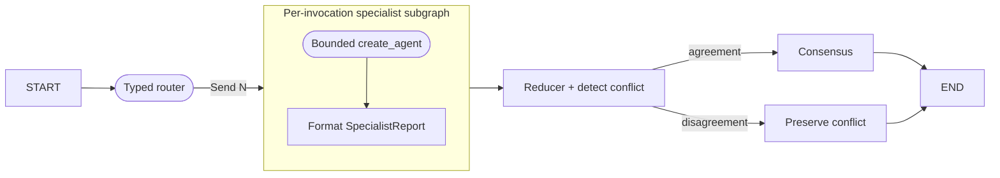

# Scenario 04 — Router + Parallel Specialists

## Problem

Route one request to only the necessary perspectives, execute them concurrently, preserve
disagreement, and combine their typed reports without making a supervisor agent the architecture.

## Choose this when

- Several independent perspectives improve a decision.
- Specialist work can run in parallel and return a small contract.
- The application must preserve conflict instead of hiding it in one answer.

## Avoid when

- Work has dependencies between tasks; use 05.
- One ordinary model call with a structured rubric is sufficient.

## Graph

## State and contracts

- `SpecialistRequest`, `SpecialistReport`, and `SpecialistResult` are boundaries.
- Root `SpecialistState.reports` uses an additive reducer for parallel writes.
- `SpecialistWorkerState` is private to the compiled subgraph.
- A wrapper maps parent state into the private schema and exposes only `reports` back to the root.

## Nodes

| Node | Kind | Responsibility | Failure behavior |
|---|---|---|---|
| `route` | Structured LLM/injected | Select an allowed specialist set | Empty/disallowed selection fails closed |
| `specialist` | Compiled subgraph | Run one bounded specialist and format report | Specialist failure fails that superstep |
| `aggregate` | Deterministic | Detect recommendation disagreement | Retains every report |
| `resolve` / `finalize` | Deterministic | Return conflict or consensus | Explicit terminal status |

## Features and decisions

Core: structured routing, `Send`, reducers, compiled subgraph, private-state mapping, bounded
`create_agent`, model-call middleware. The specialist subgraph uses per-invocation persistence by
default; the parent can receive an injected checkpointer.

## Examples

Run `example.py` as a module for the two deterministic examples below. Use [live_example.py](live_example.py) for the real-model demonstration, with local simulated dependencies. See the [run guide](../../../../docs/running-examples.md) for setup, exact commands, and expected outcomes.

| Example | Specialists | Decision shape | Useful result |
|---|---|---|---|
| Customer payment-data export | Product, delivery, security | Product and delivery approve; security requests safeguards | Explicit `needs_resolution` with every position preserved for policy review |
| Staged invoice-filter release | Product and delivery only | Both approve the feature-flagged rollout | Fast consensus without paying for an irrelevant security review |

Together they demonstrate why the router and the conflict reducer both matter: one limits work,
while the other prevents parallel opinions from being flattened into false consensus.

## Advantages and limits

Parallelism reduces latency and isolates detailed context. It increases calls and does not make
opinions independent when every specialist uses the same model and evidence. Conflict resolution
should remain a policy decision, not another unbounded agent.

## Copy into a project

1. Copy `graph.py`, tests, and optionally `testing.py`.
2. Replace specialist names and `SpecialistReport` with domain contracts.
3. Decide whether each worker should be a plain LLM node or bounded agent.
4. Keep the parent/private-state mapping; return only reducer-safe keys.
5. Select subgraph checkpointer mode deliberately and test parallel calls.

Dependencies: `langchain`, `langgraph`, `pydantic`.

## Tests

The tests prove dynamic fan-out, consensus, preserved disagreement, allowlist failure, and compiled
topology.
