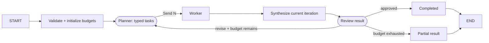

# Scenario 05 — Planner / Orchestrator-Worker

## Problem

Decompose a goal into an unknown number of independent tasks, run workers concurrently, synthesize
their artifacts, and perform a bounded review/replan cycle.

## Choose this when

- The number and shape of tasks depend on the request.
- Worker outputs can be represented by a common artifact contract.
- Partial output is more useful than an endless or failed planning loop.

## Avoid when

- The steps are fixed; use 01.
- You only need several predetermined perspectives; use 04.
- Workers depend sequentially on one another; express those dependencies as explicit nodes.

## Graph

## State and contracts

- `OrchestrationRequest`, `Plan`, `PlannedTask`, `WorkerArtifact`, `Review`, and result are typed.
- `artifacts` uses an additive reducer; each artifact records its planning iteration.
- The planner, worker, and reviewer are independent injected callables.

## Nodes

| Node | Kind | Responsibility | Failure behavior |
|---|---|---|---|
| `initialize` | Deterministic | Validate goal and budgets | Invalid boundary fails before planning |
| `plan` | Structured LLM/injected | Produce bounded independent tasks | Empty plans fail explicitly |
| `worker` | Injected function | Produce one iteration-tagged artifact | Unexpected failure stops the superstep |
| `synthesize` | Deterministic | Combine only current-iteration artifacts | Older artifacts remain audit state |
| `review` | LLM/injected | Approve or return feedback | Loop governed by iteration ceiling |
| `partial` | Deterministic | Return useful unfinished output | Explicit reason included |

## Features and decisions

Core: typed planning, dynamic `Send`, reducer, iteration-scoped aggregation, review/replan loop,
task and iteration budgets, partial terminal. Workers are plain functions by default; wrap a
bounded agent only when a worker itself needs tools or a local loop.

## Examples

Run `example.py` as a module for the two deterministic examples below. Use [live_example.py](live_example.py) for the real-model demonstration, with local simulated dependencies. See the [run guide](../../../../docs/running-examples.md) for setup, exact commands, and expected outcomes.

| Example | Planned work | Review behavior | Useful result |
|---|---|---|---|
| PostgreSQL checkout migration | Compatibility, rollout, then rollback risks | First plan is rejected for missing risk policy; second plan adds it | A zero-downtime sequence with measurable rollback triggers |
| Checkout incident handoff | Impact, active mitigation, next checks | Complete task set passes on the first iteration | A time-sensitive handoff with metrics and a 15-minute validation cadence |

The planner varies task shape by goal, workers run independent tasks in parallel, and the reviewer
controls whether another planning iteration is worth its cost.

## Advantages and limits

The pattern adapts to variable-size work while keeping the root topology explicit. Planning can be
unstable, duplicate tasks, or omit dependencies. Reviewer and planner may share model blind spots.

## Copy into a project

1. Copy `graph.py` and its tests.
2. Replace plan/task/artifact/review contracts with domain schemas.
3. Inject planner, worker, and reviewer separately; use different models only when evidence
   justifies the complexity.
4. Define task dependency, failure, timeout, and partial-result policy.
5. Preserve max-task, replan-budget, reducer, and partial-output tests.

Dependencies: `langchain`, `langgraph`, `pydantic`.

## Tests

The tests cover dynamic worker count, replan-to-success, task limits, and partial termination.
