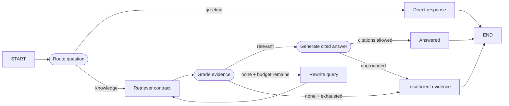

# Scenario 06 — Grounded Knowledge Workflow

## Problem

Answer from retrieved evidence with explicit routing, relevance grading, bounded query rewriting,
and citation validation. Retrieval is an injected capability; MCP is one optional adapter.

## Choose this when

- Answers must be grounded in a controlled corpus.
- The application needs explicit insufficient-evidence behavior.
- Retrieval, grading, generation, and grounding policy must be independently replaceable.

## Avoid when

- The model can answer safely without external evidence.
- The task is broader research with unknown sources and artifacts; consider 05 or 09.

## Graph

## State and contracts

- `RagRequest`, `KnowledgeDocument`, `GroundedAnswer`, and the result are typed.
- `KnowledgeClient` is the stable retrieval protocol.
- Documents and relevant evidence remain in run state; they are not long-term memory.

## Nodes

| Node | Kind | Responsibility | Failure behavior |
|---|---|---|---|
| `route` | Structured LLM/injected | Skip retrieval for direct messages | Unknown route rejected by contract |
| `retrieve` | External adapter | Return typed documents | Adapter exception fails the run/retry policy |
| `grade` | LLM/injected | Select relevant document IDs | Unknown IDs are ignored |
| `rewrite` | Injected policy | Refine query within budget | Stops at `max_rewrites` |
| `generate` | LLM/injected | Produce answer and citations | Invented citation fails grounding |

## Features and decisions

Core: retriever interface, conditional routing, grading, bounded rewrite loop, citation allowlist,
explicit not-found terminal. `mcp_adapter.py` implements the same protocol with the maintained
LangChain MCP client; `server.py` is only its local integration fixture.

## Examples

Run `example.py` as a module for the two deterministic examples below. Use [live_example.py](live_example.py) for the real-model demonstration, with local simulated dependencies. See the [run guide](../../../../docs/running-examples.md) for setup, exact commands, and expected outcomes.

| Example | Available evidence | Route | Useful result |
|---|---|---|---|
| Audit-log retention | A policy states 365-day immutable retention and legal-hold behavior | Retrieve, grade, generate, validate citation | A policy answer citing only `audit-retention-policy` |
| Vendor privilege approval | No document defines whether temporary vendors may authorize elevation | Retrieve, rewrite once, then stop | Explicit `not_found` instead of a fabricated authorization rule |

The second case is as important as the first: a grounded workflow must demonstrate refusal when
its evidence cannot answer a consequential policy question.

## Advantages and limits

Evidence and failure routes are inspectable, and MCP is not forced on projects with an existing
client. Citation membership does not prove that a claim is entailed; destination projects may add
claim-level verification or human review.

## Copy into a project

1. Copy `graph.py` and core tests.
2. Implement `KnowledgeClient` for the application's search system.
3. Copy `mcp_adapter.py` only when retrieval is genuinely provided through MCP.
4. Replace router, grader, rewrite policy, and generator independently.
5. Preserve no-evidence, rewrite-budget, and invented-citation tests.

Dependencies: core dependencies; add `langchain-mcp-adapters` and `mcp` only for the MCP adapter.

## Tests

Core tests cover direct routing, grounded answers, missing evidence, and citation rejection. An
integration test proves the optional MCP adapter satisfies the same retriever contract.

An explicitly empty corpus stays empty. The rewriter is an injected callable; the offline default adds a LangGraph keyword only for the built-in fixture corpus. The live demo uses domain-specific model rewriting.
