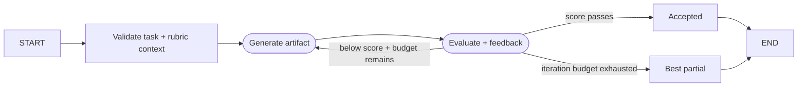

# Scenario 07 — Evaluator-Optimizer

## Problem

Generate an artifact, evaluate it against explicit criteria, and revise it until it passes or a
hard iteration limit returns the best partial result.

## Choose this when

- Output quality can be expressed as a rubric or structured evaluation.
- Revision is valuable enough to justify additional model calls.
- A bounded partial result is preferable to unlimited self-reflection.

## Avoid when

- Deterministic validation alone is sufficient.
- The evaluator cannot access stronger evidence than the generator.
- The task requires decomposition or external actions; use 05 or 08.

## Graph

## State and contracts

- `OptimizationRequest` accepts task, instructions, reference material, threshold, and budget.
- `Evaluation` and `OptimizationResult` are Pydantic boundaries.
- `OptimizerState` retains the current artifact, feedback, score, and iteration.
- Generator and evaluator are separate injected callables.

## Nodes

| Node | Kind | Responsibility | Failure behavior |
|---|---|---|---|
| `initialize` | Deterministic | Validate input and initialize loop | Invalid boundaries fail immediately |
| `generate` | LLM/injected | Produce or revise artifact | Provider/schema error fails the node |
| `evaluate` | LLM/deterministic | Return structured score and feedback | Contract enforces score range |
| `accepted` / `partial` | Deterministic | Mark explicit terminal | Partial retains latest artifact |

## Features and decisions

Core: explicit evaluator loop, typed score/feedback, threshold and iteration budget, partial
terminal. Skills are deliberately optional: `skill_adapter.py` loads an Agent Skills-compatible
directory into the request boundary without changing graph topology.

## Examples

Run `example.py` as a module for the two deterministic examples below. Use [live_example.py](live_example.py) for the real-model demonstration, with local simulated dependencies. See the [run guide](../../../../docs/running-examples.md) for setup, exact commands, and expected outcomes.

| Example | Rubric source | First-draft problem | Useful result |
|---|---|---|---|
| Resumable-workflow release notes | Optional `release-notes` Agent Skill | Missing outcome, compatibility, and validation sections | Accepted notes after feedback-guided revision |
| Checkout incident status update | Injected application evaluator, no Skill | Reports impact but omits status, mitigation, and next-update time | A complete, time-bounded public update after one revision |

The pair shows that Skills are a compatible source of instructions, not a mandatory abstraction;
the graph only needs a task, generator, evaluator, threshold, and finite budget.

## Advantages and limits

The loop and cost ceiling are visible. A model judging its own work can reinforce the same errors;
use deterministic checks, external evidence, a different evaluator, or human review where needed.

## Copy into a project

1. Copy `graph.py` and core tests.
2. Replace request, evaluation rubric, generator, and evaluator.
3. Copy `skill_adapter.py` and `skills/` only when progressive domain instructions are useful.
4. Set minimum score and maximum iterations from product policy.
5. Preserve pass-on-first, improve, and exhausted-budget tests.

Dependencies: core dependencies; add `PyYAML` only for the optional Skill adapter.

## Tests

The tests prove improvement, partial termination, operation without a Skill, Skill loading, and
path-traversal rejection.
