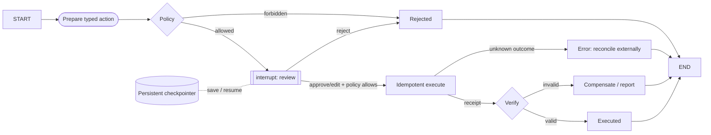

# Scenario 08 — Durable Approval and Side Effects

## Problem

Prepare a sensitive external action, pause durably for authenticated approve/edit/reject input,
then execute idempotently and verify or compensate.

## Choose this when

- A model or workflow proposes an action with real-world impact.
- Review may happen after the original process exits.
- The application needs a typed audit trajectory and safe replay.

## Avoid when

- The operation is read-only and low risk.
- The application cannot persist checkpoints or provide authenticated reviewer context.

## Graph

## State and contracts

- Intent, action payload variants, approval decision, and result are Pydantic contracts.
- Reviewer identity is read from `RunnableConfig`; it is not accepted in `Command(resume=...)`.
- `HitlState.audit` has an additive reducer.
- The executor owns idempotency records and side effects.

## Nodes

| Node | Kind | Responsibility | Failure behavior |
|---|---|---|---|
| `prepare` | LLM/injected | Produce one typed proposed action | Does not execute |
| `policy` | Deterministic | Apply injected business policy, including after edits | Denial terminates |
| `review` | Human interrupt | Validate approve/edit/reject | Missing authenticated actor fails |
| `execute` | External boundary | Apply idempotent action | Error requires reconciliation |
| `verify` / `compensate` | Deterministic/external | Confirm or undo/report | Explicit compensated terminal |

## Features and decisions

Core: persistent checkpointer, `thread_id`, `interrupt`, `Command`, authenticated runtime config,
typed edit, idempotent executor, verification, compensation, audit reducer. The review node has no
side effect before `interrupt`, because the whole node restarts when resumed.

## Examples

Run `example.py` as a module for the two deterministic examples below. Use [live_example.py](live_example.py) for the real-model demonstration, with local simulated dependencies. See the [run guide](../../../../docs/running-examples.md) for setup, exact commands, and expected outcomes.

| Example | Human decision | Durability behavior | Useful result |
|---|---|---|---|
| Duplicate-charge refund | Finance reviewer approves a prepared EUR 25 refund | Process closes before approval, reopens, resumes, then safely replays | One verified refund receipt and exactly one executor call |
| Checkout incident email | Incident commander edits recipient and subject before approval | Prepared action survives the same close/reopen boundary | The reviewed payload, not the draft, is executed and audited |

Both cases start with enough domain data to prepare a concrete action. They demonstrate that the
graph owns approval state while the executor owns idempotent side effects.

## Advantages and limits

Approval survives process boundaries and replay does not duplicate the demonstrated action.
Exactly-once delivery cannot be guaranteed by LangGraph alone; the destination executor and
external service must support an idempotency or reconciliation strategy.

## Copy into a project

1. Copy `graph.py`, tests, and the small SQLite example if useful.
2. Replace action union, preparer, policy, executor, verifier, and compensation behavior.
3. Inject a production checkpointer and server-derived actor context.
4. Persist idempotency/audit records independently of graph state where required.
5. Preserve close/reopen, reject, edit, replay, execution-error, and compensation tests.

Dependencies: core dependencies plus a persistent checkpointer; example uses
`langgraph-checkpoint-sqlite`.

## Tests

The tests exercise reject, edit, approve, compensation, SQLite close/reopen, and exactly one
executor call across replay.

The default executor is an in-memory test double. `dummy_executor.py` provides the durable SQLite simulation used by the live demo. Neither is a real payment or email adapter. A checkpointer is required at build time. `actor_id` is trusted configuration, not authentication; derive it from the application server.
