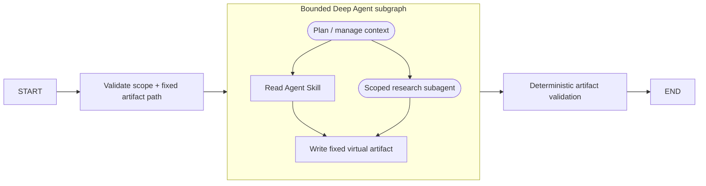

# Scenario 09 — Bounded Deep Work Agent

## Problem

Use Deep Agent planning, virtual files, Skills, and a subagent for genuinely open-ended artifact
work while an outer `StateGraph` owns scope and validates the only result allowed to escape.

## Choose this when

- A task needs variable-length context, file-based working memory, or delegation.
- The expected output is an artifact that can be deterministically validated.
- Simpler workflows 01–08 cannot express the required local autonomy.

## Avoid when

- A fixed DAG, tool loop, specialist fan-out, or planner-worker graph is sufficient.
- The task would require unrestricted host filesystem, shell, or network access.

## Graph

## State and contracts

- `DeepTaskRequest` fixes `/artifacts/result.md` at the public boundary.
- The Deep Agent receives in-state virtual files and returns them inside its private state.
- Only artifact content, status, and model-call count cross back into `DeepWorkerState`.

## Nodes

| Node | Kind | Responsibility | Failure behavior |
|---|---|---|---|
| `scope` | Deterministic | Validate task and output path | Rejects arbitrary artifact paths |
| `deep_agent` | Bounded Deep Agent | Plan, load Skill, delegate, write artifact | Model-call middleware and permissions constrain it |
| `validate` | Deterministic | Require title, evidence, and limits sections | Returns `invalid_artifact` with a `validation_error` describing missing sections |

## Features and decisions

Core: Deep Agent, `StateBackend`, Agent Skills progressive disclosure, one scoped subagent,
model-call limits, fixed output contract, deterministic validation, and first-match filesystem
permissions. Reads are allowed only under `/skills/**`; writes only to the fixed artifact; all
other built-in filesystem operations are denied.

## Examples

Run `example.py` as a module for the two deterministic examples below. Use [live_example.py](live_example.py) for the real-model demonstration, with local simulated dependencies. See the [run guide](../../../../docs/running-examples.md) for setup, exact commands, and expected outcomes.

| Example | Open-ended work | Bounded resources used | Useful result |
|---|---|---|---|
| Checkout API dependency upgrade | Assess lifecycle migration, tests, rollout evidence, and rollback limits | One researcher, artifact-author Skill, fixed virtual file, four parent calls | A validated Markdown upgrade assessment |
| Checkout latency runbook review | Find diagnostic, mitigation, ownership, and communication gaps | Same bounded worker contract with task-specific research | A validated gap review with game-day limitations |

These tasks justify a local agent loop because producing the artifact requires delegation, reading
instructions, and file work. The parent graph still fixes scope, permissions, output path, and
validation.

## Advantages and limits

The worker can manage a large local task without controlling root routing. This remains the most
expensive and risky scenario. Deep Agent filesystem permissions cover built-in filesystem tools,
not custom tools, MCP tools, or arbitrary sandbox execution; those need independent controls.

## Copy into a project

1. Copy `graph.py`, Skill directory, tests, and optionally `testing.py`.
2. Replace the task/result contract and deterministic artifact validator.
3. Select `StateBackend`, `StoreBackend`, a virtual filesystem, or a sandbox deliberately.
4. Define explicit filesystem permissions, tool allowlist, call limits, and subagent contracts.
5. Never expose a host shell or repository root merely to simplify the example.

Dependencies: core dependencies plus `deepagents`.

## Tests

The tests execute the real Deep Agent graph with deterministic models, validate the artifact
boundary, and reject malformed results.

Delegation is enforced with `ToolCallLimitMiddleware(run_limit=1)`. Both the researcher and the replacement general-purpose child are compiled agents with no tools and bounded calls. `model_calls` counts parent responses only; measure child calls and tokens separately. Artifact headings validate structure, not factual evidence. The live example supplies the actual runbook excerpt.
