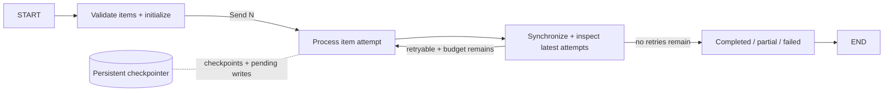

# Scenario 10 — Durable Resumable Job

## Problem

Process a variable batch concurrently, retry explicit retryable outcomes, preserve permanent
failures as partial results, and resume a failed superstep without repeating successful parallel
work.

## Choose this when

- Work may outlive one process or fail after some parallel items have completed.
- Each item can be processed independently and identified by a stable ID.
- Completed, partial, and failed terminal results are all meaningful.

## Avoid when

- The operation is a short one-shot request with no recovery requirement.
- Items have complex dependencies; model them as explicit graph edges or separate phases.
- An external workflow engine already owns retries and durable item state.

## Graph

## State and contracts

- `JobRequest` enforces stable unique item IDs and an attempt limit.
- `WorkOutcome` distinguishes completed, retryable, and permanent failure.
- `JobState.attempts` uses an additive reducer across parallel workers and retry rounds.
- `WorkRecord` and `JobResult` expose only each item's latest outcome.

## Nodes

| Node | Kind | Responsibility | Failure behavior |
|---|---|---|---|
| `initialize` | Deterministic | Validate IDs, items, and budgets | Duplicate/invalid IDs fail before work |
| `worker` | Injected function | Process one item attempt | Domain failures become outcomes; unexpected exceptions fail superstep |
| `assess` | Synchronization | Observe all writes from the worker superstep | Routes retryable latest outcomes |
| `finalize` | Deterministic | Select latest record and terminal job status | Never hides exhausted/permanent failures |

## Features and decisions

Core: dynamic `Send`, additive reducer, graph-visible retry, attempt budget, failure isolation,
partial terminal, checkpointer, pending-write resume, checkpoint history, and time-travel fork. The
SQLite example crashes one item, closes the database, reopens it, and resumes without calling the
successful item again.

Use LangGraph `RetryPolicy` instead of a graph-visible outcome when the failure is a transparent
transient exception and the product does not need attempt state. The resilience recipe compares the
two choices.

## Examples

Run `example.py` as a module for the two deterministic examples below. Use [live_example.py](live_example.py) for the real-model demonstration, with local simulated dependencies. See the [run guide](../../../../docs/running-examples.md) for setup, exact commands, and expected outcomes.

| Example | Failure shape | Recovery behavior | Useful result |
|---|---|---|---|
| Resumed document batch | One document completes while a sibling crashes the process | Reopen SQLite and resume from pending writes | Both documents complete; stable work runs once and crashed work twice |
| Mixed import batch | Product manual succeeds, vendor datasheet has one transient failure, scan is permanently unreadable | Retry only the retryable item and isolate permanent failure | Explicit `partial` result with per-item output, errors, and attempt counts |

The first case proves crash durability; the second proves business-level retry and failure policy.
They are separate concerns and a production batch normally needs both.

The optional [OpenTelemetry lab](../../../../docs/observability/README.md) instruments this same
graph with workflow/worker/model traces, correlated structured logs, metrics, and trace exemplars.
Run `otel_example.py` with `mixed`, `start`, or `resume`, optionally with `--live` and `--stream`.
It uses official OTel LangChain callbacks and declarative SDK profiles, with console export,
a local Collector/Grafana stack, a dashboard, and an investigation walkthrough.
SDK configuration and instrumentation stay in the example; `graph.py` remains independent.

## Advantages and limits

The topology handles batch recovery without an all-in-one agent. Stable item IDs and idempotent
processors remain mandatory. Checkpointing preserves graph progress; it cannot make an external
mutation exactly once without an application idempotency strategy.

## Copy into a project

1. Copy `graph.py`, tests, and optionally the SQLite example.
2. Replace `WorkItem`, `WorkOutcome`, and processor with domain contracts.
3. Decide which failures are retryable, permanent, or unexpected crashes.
4. Inject a production checkpointer and derive `thread_id` from the job identity.
5. Preserve partial-result, retry-budget, close/reopen, and no-duplicate-work tests.

Dependencies: core dependencies plus the selected persistent checkpointer; example uses
`langgraph-checkpoint-sqlite`.

For the observability variant, use the lab guide's copy checklist: `telemetry.py`, `otel_sdk.py`,
a YAML profile, exporter registration, dependencies, tests, and relevant `otel_example.py`
boundaries. The guide covers provider ownership, privacy, signal contracts, and beta API limits.

## Tests

The tests cover mixed outcomes, all-failed terminal status, pending-write recovery with an in-memory
checkpointer, SQLite close/reopen resume, topology, history, and an alternative-input fork from an
earlier checkpoint.
